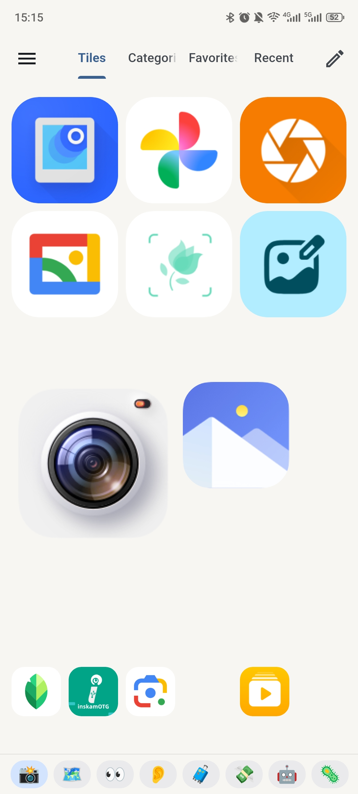
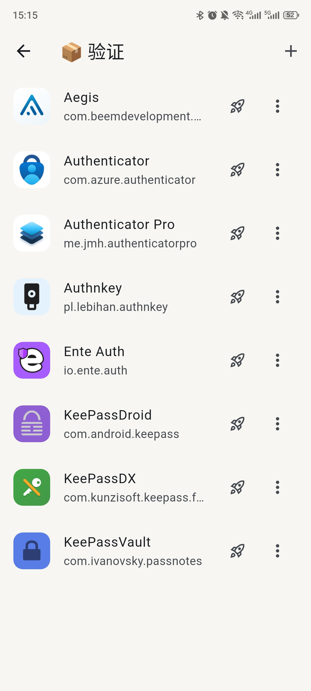
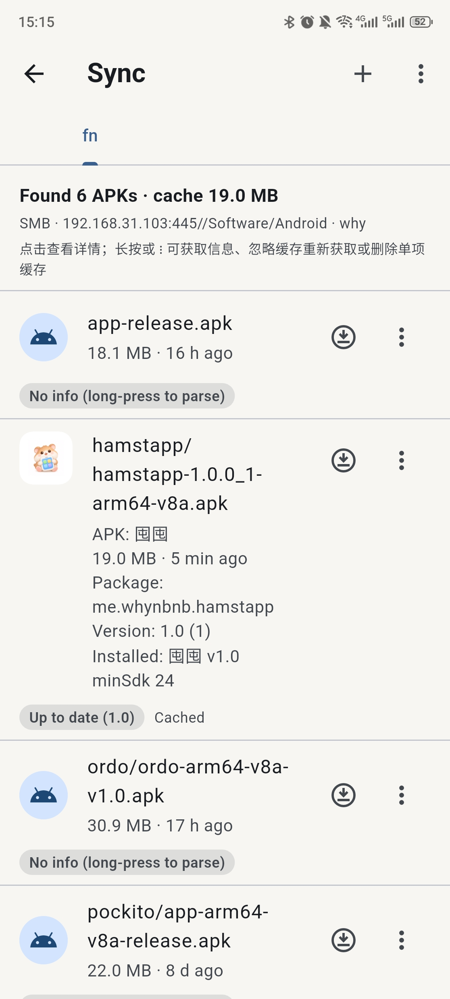

<p align="center">
  
</p>

<h1 align="center">Hamstapp · 囤囤</h1>

<p align="center"><b>A local-first Android app &amp; APK manager, with a fully customisable launcher.</b></p>

<p align="center">
  <b>English</b> ｜ <a href="README.zh-CN.md">简体中文</a>
</p>

<p align="center">
  <a href="https://flutter.dev"></a>
  <a href="https://dart.dev"></a>
  
  
  
  <a href="LICENSE"></a>
</p>

> Vibe-coded with DeepSeek V4.1 Flash / OpenCode

---

**Hamstapp** (囤囤, *tún tún* — “to hoard”) helps you keep track of everything installed on your phone:
why you installed each app, what you were using it for, which apps you actually launch — and turns all of that
into a fast, fully customisable launcher. Everything is stored locally: no account, no analytics, no telemetry.

> **The name** — *Hamstapp* is **Hamster** + **App**: a hamster stuffing apps into its cheeks.
> It pairs with the Chinese 囤囤 (*tún tún*, “to hoard”, pronounced *tún*), so the app is literally a hamster
> that hoards apps for you.

## 📸 Screenshots

<p align="center">
  
  
  
</p>

## ✨ Features

### 🚀 Launch
- **Tile board** — a free-form grid where each app is a tile you can move and resize (1×1 up to 6×6).
  Multiple pages, per-tile label / padding / border, and two looks: **Colorful** and **Glass**.
- **Info tiles** — 30 kinds of live tiles that need no app behind them, in five groups the picker can
  filter by (Readings / Apps / 囤囤 / Tools / Actions):
  - *Readings* — clock, date, battery (level, temperature or both), storage, RAM, today's screen time,
    this month's mobile + Wi-Fi data, the next alarm, uptime, live network speed, unread total.
  - *Apps* — recently used, most used (or suggested for this time of day), new installs, long unused,
    favourites, biggest, and **folders** (a category, or a hand-picked set, opening as a grid).
  - *囤囤* — the latest snapshot and what changed since, apps still to sort out, the download cache,
    and a backup list's installed / missing counts.
  - *Tools* — torch, quick dial, countdown, world clock (optional date, or its difference from today),
    a note, and a battery / RAM / storage / data overview.
  - *Actions* — scan apps, take a snapshot, search apps, open the storage manager.
- **Tile gestures** — bind an action to a double tap or an upward swipe on any tile (open the app,
  its details, search, or jump to a page). Off by default, so a plain tap still launches instantly.
- **Drag one tile onto another** to make a real folder; dropping onto an existing folder adds to it.
- **Multi-select** (delete or move a batch to another page), **copy a page** with all its tiles, and
  **lock the layout** so nothing moves by accident.
- **App shortcuts** — long-press a tile to open the app's own long-press menu (WeChat's "Scan", …).
  Android only shows those to the current launcher, so this needs 囤囤 to be the default home app;
  the menu explains that instead of failing silently.
- **Global search** — one search icon in the header covers apps (including web entries), categories,
  backup lists, snapshots and a handful of screens that are otherwise buried in Settings.
- **Categories** — group apps with an emoji and a colour; reorder by hand or by name / count.
- **Favorites** — a quick grid of the apps you starred.
- **Recent** — launch history with *all / today / 7-day / 30-day* filters, sorted by recency or frequency,
  plus time-of-day **recommendations** learned from your habits. The list fixes its order when you
  enter the tab — launching an app updates its count and time but never makes the other rows jump —
  and re-sorts when you come back to it. Usage-sorted info tiles (最近使用 / 常用 / 长期未打开) do the
  same while their page stays open.
- **Notification badges** — grant notification access, turn on *Capture notifications*, and app icons
  get an unread bubble: choose **count / dot / hidden**, set separately for the tile board and the rest.
  Badges follow **unread** semantics: dismissing a notification keeps the bubble, which clears when you
  open it, the app withdraws it, or you launch the app from 囤囤.
- **Launcher shortcuts** — long-press 囤囤's own icon for *Scan apps*, *Recent* and *Tiles*.

### 🖥 Home-screen widget
- **Recommended apps on the desktop.** A native Android widget (no Flutter engine, no background
  service) shows the same apps as **Recent → Recommendations** for the current hour — at most two
  rows — or the most used / pinned apps when there are no suggestions yet. The widget follows the
  system light / dark theme.
- **Icons stay put within the hour.** The layout picked for the current hour is kept even when you
  launch one of its apps, so the grid never shifts under your finger (and never looks like the tap
  landed on the wrong icon). It refreshes at the next hour, or right away from the refresh button in
  the widget settings. 最近 → 推荐 follows the same rule.
- **Tile page tabs (4×1).** A slim second widget with the tile board's pages; tap a tab to open
  that page in 囤囤. Only the current page is marked — the rest are plain labels, so a short list
  never turns into stretched grey buttons. The marker can be a pill behind the label or, from the
  options, a small dot underneath it. Emoji page names are drawn large (up to 30sp) and shrink
  step by step as pages are added; only when they truly cannot fit do they share the row equally
  (with a “…” for the rest). Its page list is pushed whenever the tabs change, so it does not need a
  periodic refresh.
- **A tap launches directly and still counts.** Widget taps are recorded natively, then merged into
  囤囤's launch log the next time it opens, so the app also shows up in *Recent*, the usage trends
  and later recommendations. Apps launch through the same pinned launcher entry as the tile board
  (icon, label and activity), and hand-added web apps open in their own window (or the chosen browser).
  A web app (PWA) also carries a small globe badge in the corner of its icon, matching the *网页* tag
  the app list shows next to its name.
- The header's right side carries three shortcuts — **Apps**, **Recent** and **Search** — so the
  panel is useful even when the suggestion it shows is not the one you want.
- **Options** (Settings → Tiles → Home screen widget): hide the app names for a tighter grid, cap it
  at **4 / 6 / 8 apps** (4 fills exactly one row), lay out a partial row **evenly**, **packed left**
  or **pushed to the two ends**, and clip the icons to **rounded squares**. Icons keep their own
  silhouette by default.
- Add it from **Settings → Tiles → Home screen widget**; the same screen has a live preview and a
  switch to hide app names. A lightweight half-hour alarm keeps repainting it (and switching to the
  current hour's suggestions) even when 囤囤 has not been opened; the suggestion *data* is recomputed
  whenever 囤囤 runs, while the current hour's layout stays put.

### 📦 App manager
- Scan installed apps (optionally including system apps); the list is cached for instant launch.
- **Quick search**: the field at the top of the app list (hinted *Quick search*) filters as you
  type — **name, package, pinyin initials, full pinyin** or a fuzzy subsequence. The × in the field
  clears just the search text, **Advanced** beside it opens the full page, and a long press on the
  magnifier explains the split.
- **Advanced search**: tap Advanced to combine a search with a scope (all / user / system), state
  (favorite, categorised, has a reason, unorganized, uninstalled…), category, sort order and
  grouping, plus your recent searches. The bottom bar shows how many apps match; **Apply** writes the
  conditions to the list, which is never interrupted while you are still choosing. The × beside the
  field clears just the search text; only 重置 clears everything. The `size:`, `cat:`, `source:` …
  syntax works in both, with its reference behind the ?.
- Applied conditions stay visible above the list (scope, state, category); remove one individually or
  clear them all. The filter and sort you leave behind are remembered.
- Per-app page: launch, favourite, pin to tiles, install **reason**, **note**, categories, usage stats,
  APK analysis, export / share the APK, open the system app-info screen, uninstall — plus three cards:
  - **Storage** — APK, data and cache, a proportion bar, and a shortcut into the system screen to clear it.
  - **Permissions** — everything the app requests, sensitive and granted ones first, with a tap into the
    system permission screen.
  - **Signature** — the certificate fingerprint (tap to copy), subject, validity, and flags for
    self-signed / multiple signers / rotated keys.
- **Hidden apps** — hide an app from the list without deleting anything it carries (categories,
  reason, notes); the 「隐藏」 filter is where it comes back from.
- **Custom icons** — pick an image for any app; it is shrunk to 192 px and used everywhere (list,
  tiles, search) until you restore the launcher icon.
- **Icons follow app updates** — after an app is installed or updated, 囤囤 re-reads only the icons
  that changed (judged by the system's install / update time) on start-up, when it returns to the
  foreground, or on a scan. If one icon is still wrong, the app detail menu has **Force refresh
  icon**, which skips both the in-memory and the on-disk copy and asks the system again.
- **整理与体检 (Health)** — one screen for the things worth noticing: updates that added sensitive
  permissions or changed signer, the install-source breakdown, apps sharing a name (highlighted when
  their certificates differ), packages with several downloaded versions, and the hidden apps.
- **Real usage** — per-app foreground time for today / 7 / 30 days and this month's traffic per app,
  straight from the system (usage access), next to 囤囤's own launch history.
- **Uninstall records** — when an app disappears it is kept together with the reason you give,
  so reinstalls and snapshots stay meaningful.

### 🔐 Permissions & storage
- **Permission audit** — the other direction: for each capability, who holds it. Microphone, camera,
  location (and background location), contacts, phone & call log, SMS, photos / music / files, calendar,
  body sensors, notifications, draw-over-other-apps, install-unknown-apps, modify system settings,
  usage access, notification access, accessibility and the battery-optimisation whitelist — each entry
  taps through to the app.
- **Storage manager** — what 囤囤 itself is using (icon cache, scan cache, downloaded APKs, scratch files,
  other data), with per-row clearing, plus an **app usage ranking** (APK + data + cache per app, biggest
  first, straight to the system clear screen).
- Where Android requires a grant — *usage access* for per-app sizes, screen time and data — the screen
  says so and offers the switch instead of showing zeros.

### 🌐 Web apps
- Installed **web apps** (WebAPK / Trusted Web Activity) are detected during a scan and marked with a 🌐,
  and can be inspected from Settings → 网页应用检测.
- Add a website by hand and it becomes a first-class entry: same list, tiles, favourites, categories,
  search and usage log as an app, with its own icon.
- 囤囤 reads the site's **web app manifest** (name, start URL, scope, display mode, theme / background
  colour, icons) and opens it the way the site asks for: a **standalone window** (its own task, no address
  bar, per-entry status-bar behaviour), or handed to a **browser you choose**.
- Leave the manifest's scope and the window stays, but shows an address bar — the standard's rule for
  sign-in pages on another host — so logins keep the same session instead of being thrown to a browser.
- This is 囤囤's own WebView host, so it does not share cookies with your browser; when a tap needs a real
  browser, 囤囤 asks the system where the URL would go and prefers an installed web app, so it can open in
  the browser's own app window when one exists.

### 🗂 Snapshots & backup
- **Snapshots** capture the installed list and all your annotations (including app icons), so you can
  **diff** two points in time (added / removed / updated) and **restore** annotations later.
- **Backup lists** are curated sets of packages with installed / missing counts — handy as reinstall checklists.

### 🌐 Remote APK sources
- Browse and install from **FTP**, **SMB / Samba** and **WebDAV** sources.
- At a glance: new, update, already installed, or newer-than-yours; one-tap download + install.
- **Explicit refresh** (the refresh button in the header, or pull down); a thin bar shows the reload.
- Sort the list **by name** (pinyin-aware) or **by update time** (newest first); the choice is remembered.
- Download **cache** with per-file version history, *keep all versions*, orphan cleanup and size reporting.
- **APK analyzer**: SHA-256 / MD5 hashes, manifest flags, component counts, permissions & features,
  native ABIs / DEX / zip breakdown, and v1 / v2 / v3 signing certificates — including a signature
  match check against the installed app before updating.

### 📈 Usage insights
- **Stats** over 7 / 30 / 90 days: most used, **neglected** (used before, then stopped) and never-launched apps.
- **Recommendations** based on the time of day you usually open each app.

### 🔒 Data & privacy
- **Export / import** the whole state as one JSON package. Import shows what the package holds and
  how much of it is already here, and can **merge** instead of replacing everything.
- **Back up to WebDAV** — write the package into one of the configured WebDAV folders, and restore
  from the list of backups there (same preview/merge step).
- **Snapshot difference export** — the comparison page writes its result (versions, new/removed
  permissions, signer changes) to a Markdown file.
- **Automatic snapshots** — off by default; when enabled, a scan that finds changes after N days
  takes one on its own.
- A persistent **icon cache** so icons appear instantly, stamped with the app version each icon was
  read from so an update only re-reads the icons that changed; a full refresh is in Settings.
- **Offline by default** — the only network access is the remote sources you configure yourself.
- **Notification badges** are read on-device from the system notification access you grant; nothing is uploaded.
- An **opt-in log** (off by default) records scan / install / sync / launch / notification events on-device;
  filter it by module and copy the result when reporting a problem.

### 🎨 Interface
- Light / dark / system theme, custom seed colour, **Chinese & English**.
- **Date format** — five styles (`2026-10-17`, `2026/10/17`, `10/17/2026`, `17/10/2026`,
  `2026年10月17日`) and 24-hour or `1:05 PM`; one setting drives every screen and tile.
  Relative times (`3 days ago`, `today`) stay relative.
- Navigation: bottom bar, side rail, or a collapsed button.
- **Icon packs** — use the icons of an installed icon pack instead of the launcher's (the platform
  appfilter convention; system icons stay the default).
- **Font size and density** — 85 / 100 / 115 / 130 % on top of the device's own scale, and a compact
  list density.
- On a tablet or in landscape the app list and the app page sit side by side instead of pushing pages.
- Adjustable haptics, optional full-screen (hide the status bar), remember last position.

## 📥 Install

Download the latest `hamstapp-*-arm64-v8a.apk` from the [Releases](https://github.com/whynbnb/hamstapp/releases)
page and install it on an **arm64-v8a** device running **Android 7.0+ (API 24)**.

Some features ask for extra grants and work without them: **notification access** (unread badges),
**usage access** (per-app sizes, screen time, data), **install unknown apps** (installing from a source),
and **all-files / package visibility** for the scan.

## 🛠 Build from source

Requires the [Flutter SDK](https://docs.flutter.dev/get-started/install) (Dart 3) and the Android SDK.

```bash
git clone https://github.com/whynbnb/hamstapp.git
cd hamstapp
flutter pub get

# Run on a connected device
flutter run

# Slim, obfuscated arm64-v8a release APK -> dist/
bash scripts/release.sh
```

## 🧱 Tech stack

- **Flutter / Dart 3** with `provider` for state, `path_provider` for local JSON storage,
  `lpinyin` for search and `file_picker` for import/export.
- A small **Kotlin** `MethodChannel` plugin on top of the Android `PackageManager`:
  app scan & icons, launching, install / uninstall / share, APK parsing & signing,
  storage & usage statistics, permissions and app-ops, camera torch, FTP (`commons-net`),
  SMB (`jcifs-ng`) and vibration.
- **WebDAV** is implemented in Dart over HTTP.

## 🚫 Not planned

These are deliberately out of scope. They need system-level privileges, vendor private APIs, or
would break the local-first design, so they will not be added — listed here so they stop coming
back as suggestions:

- **Freezing / disabling apps** — Shizuku, root or device-owner; too much setup and risk for what it adds.
- **Autostart / background management** — every vendor hides its own components; supporting it means
  hard-coding each ROM.
- **Battery-drain ranking** — `BatteryStats` is only readable with system-level permissions.
- **Weather or other cloud data** — needs network and location; the app stays offline by default.
- **Accounts / a sync service** — no account, no telemetry, no server of ours.

## 📝 Changelog

- **1.1** — permission audit; per-app storage / permissions / signature cards; storage manager and app
  usage ranking; 30 info tiles with their own settings; web-app entries with a standalone window or a
  browser of your choice; launcher shortcuts; date-format and 24-hour settings; “unsupported tile”
  handling instead of silent removal.
- **Unreleased** — tile gestures, drag-into-folder, multi-select / page copy / layout lock, app
  shortcuts, global search; hidden apps, custom icons, 整理与体检, per-app usage and traffic, install
  source breakdown; icon packs, font size / density, two-pane tablets; auto snapshots, WebDAV
  backup, preview/merge import, snapshot-difference export; home-screen widget with hourly
  recommendations whose taps count as launches; recommendation layouts and usage-sorted lists keep
  their order while you are looking at them, so a launch never shifts the other icons; widget options
  for app names, the 4 / 6 / 8 app limit, rounded icons and the partial-row layout (even / left /
  ends); a pill or a dot marking the current page in the 4x1 strip; a globe badge on web apps;
  icons refresh promptly after an app update, and a single icon can be force-refreshed from its
  detail page; a quick search (filters as you type) and an Advanced search (combined filters, sort
  and a live result count); queued, atomic settings saves so a preference file can no longer be
  lost; icon lookups moved off the UI thread and icon saves batched, so lists and scans stay smooth.
- **1.0** — first release: app manager, tile board and categories, snapshots and backup lists,
  remote APK sources with the APK analyzer, usage insights, export / import.

## 📄 License

Released under the [MIT License](LICENSE).

Copyright (c) 2026 0x574859
