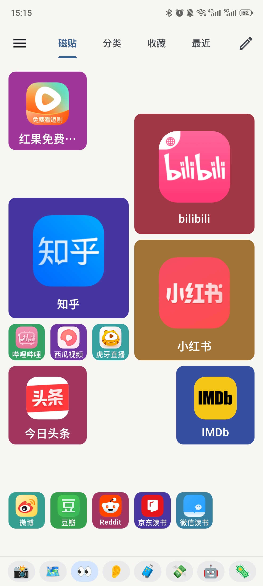
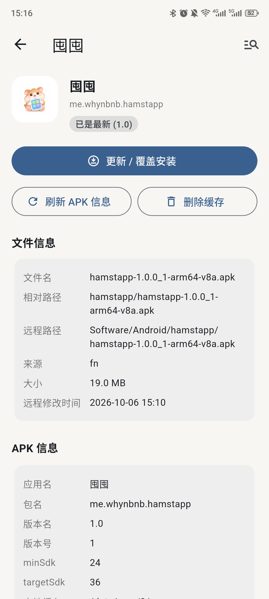
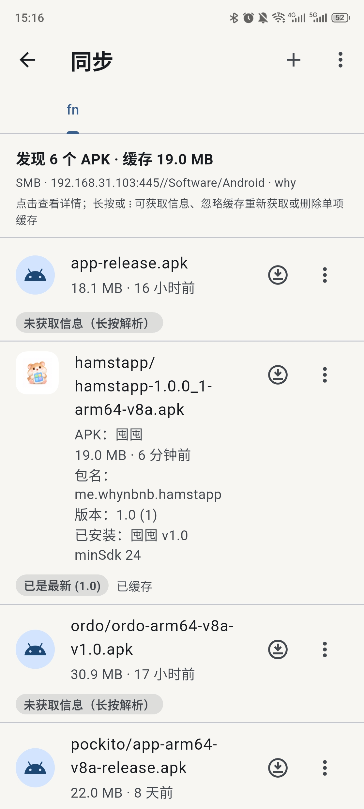

<p align="center">
  
</p>

<h1 align="center">囤囤 · Hamstapp</h1>

<p align="center"><b>本地优先的 Android 应用 / APK 管理器，也是一款可完全自定义的启动器。</b></p>

<p align="center">
  <a href="README.md">English</a> ｜ <b>简体中文</b>
</p>

<p align="center">
  <a href="https://flutter.dev"></a>
  <a href="https://dart.dev"></a>
  
  
  
  <a href="LICENSE"></a>
</p>

> 用 DeepSeek V4.1 Flash / OpenCode 氛围编程而成

---

**囤囤**（Hamstapp）帮你把手机上装过的东西理清楚：当初为什么装它、拿它做什么、到底常用哪几个 ——
再把这一切变成一款顺手的、可完全自定义的启动器。所有数据都存在本机：没有账号、没有统计、没有上传。

> **名字** —— *Hamstapp* 是 **Hamster**（仓鼠）+ **App**：一只把应用塞满腮帮子的仓鼠。
> 中文叫「囤囤」，所以它字面上就是一只替你把应用囤起来的仓鼠。

## 📸 截图

<p align="center">
  
  
  
</p>

## ✨ 功能

### 🚀 启动
- **磁贴板** —— 自由网格，每个应用是一块可移动、可缩放的磁贴（1×1 到 6×6）。支持多页、
  单块磁贴的名称 / 内边距 / 边框开关，两种外观：**多彩**与**通透**。
- **信息磁贴** —— 30 种不依赖任何应用的实时磁贴，选择器里按
  「读数 / 应用 / 囤囤 / 工具 / 动作」分组并支持筛选：
  - *读数* —— 时钟、日期、电量（百分比 / 温度 / 两者）、存储空间、内存、今日屏幕用时、
    本月流量、下一个闹钟、运行时长、实时网速、未读汇总。
  - *应用* —— 最近使用、常用（或按时间段推荐）、新装应用、长期未打开、收藏、占用最大，
    以及**文件夹**（某个分类或自选几个应用，点开是网格）。
  - *囤囤* —— 上次快照与之后的差异、待整理应用数、下载缓存、某个备份列表的已装 / 缺失。
  - *工具* —— 手电筒、一键拨号、倒计时、世界时钟（可选显示日期，放不下时显示与当天的差值）、
    便签、以及电量 / 内存 / 存储 / 流量的状态总览。
  - *动作* —— 扫描应用、新建快照、搜索应用、存储管理。
  - 每块磁贴都有自己的设置（编辑模式下点磁贴 → 「磁贴设置」）；版本升级后不再支持的类型
    会保留成「不支持的小组件」并询问是否移除，而不是悄悄消失。
- **磁贴手势** —— 给任意磁贴绑定双击 / 上滑动作（启动、详情、搜索、跳到某一页）。默认不启用，
  所以普通点击仍然是立即启动。
- **拖拽成文件夹** —— 把一个磁贴拖到另一个上就是真文件夹；拖到已有文件夹会加进去。
- **多选**（批量删除、批量移到别的页）、**复制页面**（连同磁贴）、**锁定布局**（防误拖）。
- **应用快捷方式** —— 长按磁贴打开应用自己的长按菜单（微信的「扫一扫」等）。Android 只把
  这些交给当前桌面应用，所以需要把囤囤设为默认桌面；不设置时会说明原因，而不是默默失败。
- **全局搜索** —— 标题栏一个搜索按钮，覆盖应用（含网页入口）、分类、备份列表、快照，以及
  几个平时埋在设置里的页面。
- **分类** —— 给应用分组，带表情与颜色；可手动排序或按名称 / 数量排序。
- **收藏** —— 你标星的应用组成的快捷网格。
- **最近** —— 启动历史，可按 *全部 / 今天 / 7 天 / 30 天* 过滤，按最近或次数排序，
  另有从使用习惯里学出来的**按时间段推荐**。
- **通知角标** —— 授予通知使用权并打开「捕获通知」后，应用图标会显示未读气泡：
  可选**数字 / 红点 / 不显示**，磁贴板与其它位置可分别设置。角标遵循**未读**语义：
  划掉通知仍保留，打开它、应用自己撤回，或从囤囤启动该应用时才清除。
- **长按快捷方式** —— 长按囤囤自己的图标可直接「扫描应用 / 最近使用 / 磁贴」。

### 🖥 桌面小组件
- **把推荐应用放到桌面。** 原生 Android 小组件（不启动 Flutter 引擎、不使用后台服务）显示和
  「最近 → 推荐」完全相同的应用，至多两行；完全没有推荐时，再显示常用 / 已固定磁贴的应用，
  并跟随系统深色 / 浅色。
- **点一下就启动，并且会计数。** 小组件里的点按由原生侧记录，囤囤下次打开时并入启动记录，
  所以它同样会出现在「最近」、使用趋势和之后的推荐里。应用走的是和磁贴板相同的那个入口
  （图标、名称、Activity 都一致）；手动添加的网页 / PWA 会在独立窗口或指定浏览器里打开。
- 入口：**设置 → 磁贴 → 桌面小组件**。同一页有实时预览，以及「显示应用名称」开关。
  一个轻量的半小时闹钟会让它持续重绘（并切到当前小时的推荐），即使囤囤没有打开；
  推荐内容本身则在你使用囤囤时重新计算。

### 📦 应用管理
- 扫描已安装应用（可选是否含系统应用），结果缓存，下次秒开。
- 搜索支持**名称、包名、拼音首字母、全拼**与模糊子序列。
- 按范围（全部 / 用户 / 系统）、状态（收藏、已有分类、有原因、未整理、已卸载…）与分类过滤；
  按名称、安装时间、更新时间、大小排序。**离开时的筛选与排序会被记住**。
- 应用详情页：启动、收藏、固定到磁贴、安装**原因**、**备注**、分类、使用记录、APK 分析、
  导出 / 分享安装包、打开系统应用信息、卸载 —— 以及三张卡片：
  - **存储占用** —— 安装包、数据、缓存与比例条，并可直接跳到系统设置清理。
  - **权限** —— 该应用申请的全部权限，敏感项与已授予项排在前面，可跳到系统权限页。
  - **签名** —— 证书指纹（点按复制）、主体、有效期，以及自签名 / 多重签名 / 密钥轮换标记。
- **隐藏应用** —— 从列表里藏起来，但分类、原因、备注一律保留；「隐藏」筛选是它回来的地方。
- **自定义图标** —— 给任意应用换一张图，会缩到 192px 后用在列表、磁贴、搜索里，也可以恢复默认。
- **整理与体检** —— 一处看完值得注意的事：更新后新增敏感权限或换了签名、安装来源分布、
  同名应用（签名不同会高亮）、缓存里有多版本的包、以及隐藏的应用。
- **真实使用** —— 系统记录的逐应用前台时长（今天 / 7 天 / 30 天）与本月逐应用流量，
  和囤囤自己的启动记录放在一起看。
- **卸载记录** —— 应用消失时连同你填写的原因一起保留，重装与快照对比仍然有意义。

### 🔐 权限与存储
- **权限体检** —— 反查方向：每种能力现在被谁拿到了。覆盖麦克风、相机、定位（含后台定位）、
  通讯录、电话与通话记录、短信、照片 / 音乐 / 文件、日历、身体传感器、发送通知、悬浮窗、
  安装未知应用、修改系统设置、使用情况访问、通知使用权、无障碍服务与电池优化白名单，
  每一项都能点进对应应用。
- **存储管理** —— 囤囤自己占用了什么（图标缓存、扫描缓存、下载的安装包、临时文件、其它数据），
  可逐项清理；旁边还有**应用占用排行**（每个应用的安装包 + 数据 + 缓存，从大到小，
  一键跳到系统清理页）。
- 需要系统授权的地方 —— 逐应用大小、屏幕用时、流量需要**使用情况访问** —— 界面会明确说明
  并给出开关，而不是显示一堆零。

### 🌐 网页应用
- 扫描时识别已安装的**网页应用**（WebAPK / 受信任的 Web Activity）并打上 🌐 标记，
  可在「设置 → 网页应用检测」里查看识别情况。
- 手动添加的网站是一等公民：和应用一样出现在列表、磁贴、收藏、分类、搜索与使用记录里，
  并拥有自己的图标。
- 囤囤会读取站点的 **Web App Manifest**（名称、启动地址、scope、显示模式、主题 / 背景色、图标），
  按站点要求的方式打开：**独立窗口**（独立任务、无地址栏、每入口单独的状态栏策略），
  或交给**你指定的浏览器**。
- 离开清单里的 scope 时窗口保留、只多显示一条地址栏（这是 MDN 对 scope 的标准说明），
  登录流程因此能保持同一会话，不会被甩到浏览器里。
- 独立窗口是囤囤自己的 WebView，**与浏览器不共享 cookie**；当一次点击确实需要浏览器时，
  囤囤会先问系统这个地址会交给谁，并优先使用已安装的网页应用，让它在浏览器自己的窗口里打开。

### 🗂 快照与备份
- **快照**记录已安装列表与全部标注（含应用图标），可对比两个时间点的**新增 / 卸载 / 更新**，
  也可只恢复标注。
- **备份列表**是自选的包集合，会显示已装 / 缺失数量，适合当重装清单。

### 🌐 远程 APK 源
- 浏览并安装来自 **FTP**、**SMB / Samba**、**WebDAV** 的安装包。
- 一眼看出：全新、可更新、已安装、或比你机器上的更新；一键下载 + 安装。
- 下载**缓存**：单个文件的版本历史、*保留所有版本*、孤包清理与占用统计。
- **APK 分析**：SHA-256 / MD5、清单标记、组件数量、权限与特性、原生 ABI / DEX / 压缩包结构，
  以及 v1 / v2 / v3 签名证书 —— 更新前还会比对它与已安装应用的签名是否一致。

### 📈 使用趋势
- **统计** 支持 7 / 30 / 90 天：最常用、**被冷落**（以前常用后来没再打开）、从未启动。
- **推荐**基于你平时在一天中什么时候打开某个应用。

### 🔒 数据与隐私
- **导出 / 导入**整个状态为一个 JSON 数据包。导入会先列出数据包里有什么、本机已有多少，
  并且可以**合并**而不是清空重来。
- **备份到 WebDAV** —— 把数据包写进已配置的 WebDAV 目录，也能从那里的备份列表恢复
  （同样先预览再合并/替换）。
- **快照差异导出** —— 对比页把结果（版本变化、新增/移除权限、签名变化）写成 Markdown 文件。
- **自动快照** —— 默认关闭；开启后，若距上次快照超过设定的天数且扫描发现变化，就自动创建。
- 持久化的**图标缓存**让图标秒显，也可按需刷新。
- **默认离线** —— 唯一的联网只来自你自己配置的远程源。
- **通知角标**只在你授权的通知使用权范围内、在本机读取，不上传任何内容。
- **可选日志**（默认关闭）在本机记录扫描 / 安装 / 同步 / 启动 / 通知事件，可按模块筛选并复制，
  方便反馈问题。

### 🎨 界面
- 浅色 / 深色 / 跟随系统，自定义主题色，**中文与 English**。
- **日期格式** —— 五种样式（`2026-10-17`、`2026/10/17`、`10/17/2026`、`17/10/2026`、
  `2026年10月17日`）与 24 小时制（关掉即 `1:05 PM`）；一处设置，所有页面与磁贴统一生效，
  相对时间（`3 天前`、`今天`）仍保持相对。
- 导航：底部栏、侧边栏，或折叠成按钮。
- **图标包** —— 使用已安装图标包里的图标（按平台通用的 appfilter 约定读取），默认仍是系统图标。
- **字体大小与密度** —— 在系统缩放之上再选 85 / 100 / 115 / 130%，列表可选紧凑密度。
- 平板或横屏下，应用列表与应用详情并排显示，不再层层跳页。
- 可调触感反馈、可选全屏（隐藏状态栏）、记忆上次位置。

## 📥 安装

从 [Releases](https://github.com/whynbnb/hamstapp/releases) 下载最新的
`hamstapp-*-arm64-v8a.apk`，安装到 **arm64-v8a**、**Android 7.0+（API 24）** 的设备上。

部分功能需要额外授权，没有授权也能正常使用其余功能：**通知使用权**（未读角标）、
**使用情况访问**（逐应用大小、屏幕用时、流量）、**安装未知应用**（从源安装）、
以及扫描需要的**包可见性 / 全部文件访问**。

## 🛠 从源码构建

需要 [Flutter SDK](https://docs.flutter.dev/get-started/install)（Dart 3）与 Android SDK。

```bash
git clone https://github.com/whynbnb/hamstapp.git
cd hamstapp
flutter pub get

# 在已连接的设备上运行
flutter run

# 精简、混淆的 arm64-v8a 发布 APK -> dist/
bash scripts/release.sh
```

## 🧱 技术栈

- **Flutter / Dart 3**：`provider` 管状态，`path_provider` 存本地 JSON，
  `lpinyin` 做搜索，`file_picker` 做导入导出。
- 一个小的 **Kotlin** `MethodChannel` 插件，基于 Android `PackageManager`：
  应用扫描与图标、启动、安装 / 卸载 / 分享、APK 解析与签名、存储与使用统计、权限与 app-ops、
  相机手电筒、FTP（`commons-net`）、SMB（`jcifs-ng`）与振动。
- **WebDAV** 用 Dart 在 HTTP 上实现。

## 🚫 有意不做

下面这些是有意排除的：要么需要系统级权限、厂商私有接口，要么会破坏「本地优先」的定位，
所以不会加入。集中写在这里，避免一遍遍被重新提起：

- **冻结 / 停用应用** —— 要 Shizuku、root 或设备所有者权限，门槛和风险都不划算。
- **自启动 / 后台管理** —— 各家 ROM 的组件都是私有的，支持它就得硬编码厂商。
- **耗电排行** —— `BatteryStats` 只有系统级权限可读。
- **天气等云数据** —— 需要联网和定位，与默认离线冲突。
- **云账号 / 同步服务** —— 没有账号、没有统计、没有我们的服务器。

## 📝 更新记录

- **1.1** —— 权限体检；应用详情页的存储 / 权限 / 签名卡片；存储管理与应用占用排行；
  30 种可逐块配置的信息磁贴；网页入口（独立窗口或指定浏览器）；长按快捷方式；
  日期格式与 24 小时制设置；不再支持的类型改为「不支持的小组件」提示而非静默删除。
- **未发布** —— 磁贴手势、拖拽成文件夹、多选 / 复制页面 / 锁定布局、应用快捷方式、全局搜索；
  隐藏应用、自定义图标、整理与体检、逐应用使用时长与流量、安装来源分布；图标包、字体大小 /
  密度、平板双栏；自动快照、WebDAV 备份、预览与合并导入、快照差异导出；桌面小组件
  （按小时推荐，点按计入启动次数）。
- **1.0** —— 首个版本：应用管理、磁贴板与分类、快照与备份列表、远程 APK 源与 APK 分析、
  使用趋势、导出 / 导入。

## 📄 许可证

基于 [MIT 许可证](LICENSE) 开源。

Copyright (c) 2026 0x574859
